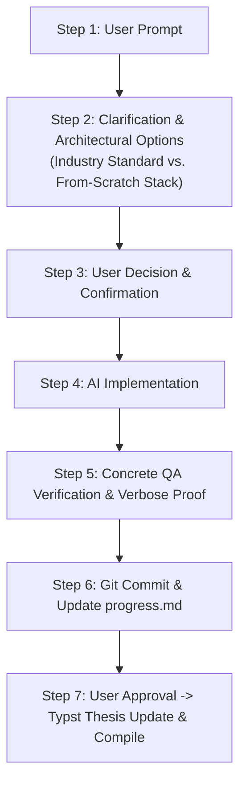
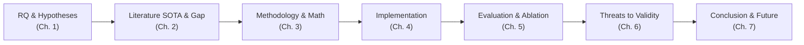

# AGENT WORKFLOW & ENGINEERING PLAYBOOK
> **Version:** 1.0  
> **Target Audience:** Incoming AI Agents (Cursor, Windsurf, Claude, Gemini, Antigravity)  
> **Scope:** Standardized Operating Procedures, Coding Conventions, Tooling, QA, and Thesis Documentation Protocol.

---

## 1. Core Operating Philosophy & The "Golden Life-Cycle"

Any AI agent interacting with this repository **MUST strictly follow the 7-step Life-Cycle**. Under no circumstance should an agent bypass clarification or jump straight to writing code or modifying thesis files without user alignment.



### Step 1: User Prompt Analysis
- Carefully analyze requirements, research intent, and technical scope.
- Identify ambiguities, potential architectural bottlenecks, or missing prerequisites before proposing solutions.

### Step 2: Clarification & Decision Presentation (The Dilemma Pattern)
When architectural or technical decisions are needed, the agent must **never choose unilaterally**. Present structured options with explicit trade-offs:
- **Option A (Industry Standard / Managed / High-level):** Faster delivery, battle-tested, but may offer lower research novelty for a CS thesis.
- **Option B (Custom / From-scratch / Low-level):** Higher engineering complexity, deeper mathematical/algorithm control, higher academic value for graduation thesis evaluation.
- Clearly present: **Complexity**, **Latency/Performance**, **Academic Value (Research Contribution)**, and **Maintenance Effort**.

### Step 3: User Decision & Confirmation
- Wait for the user to make the explicit choice or provide steering before touching any codebase files.

### Step 4: AI Implementation
- Implement the agreed-upon option adhering strictly to Clean Architecture, modern Python standards, and error-layering rules.

### Step 5: Concrete QA Verification (Proof Over Promises)
- **Zero Hallucination Policy:** Never tell the user "it works" or "it is completed" without verifiable execution logs.
- Provide or run automated/manual test scripts (e.g., PowerShell `.ps1` or Python test scripts) with **verbose logging**.
- Display exact HTTP status codes, payload structures, database rows, or benchmark metrics.

### Step 6: Git Commit & Progress Tracking
- Commit changes using **Conventional Commits** (`feat:`, `fix:`, `docs:`, `chore:`, `test:`).
- **Mandatory:** Append the exact commit hash and summary to `progress.md`.

### Step 7: Thesis Writing (Typst)
- **STRICT GATE:** **NEVER** write or edit Typst chapters while feature implementation is still in progress.
- Only update `report/chapters/` **after** the user explicitly confirms the feature is done.
- Always compile and verify zero errors immediately after modifying Typst files.

---

## 2. Environment & Tooling (Windows + Scoop Ecosystem)

### 2.1. Windows OS Quirks & PowerShell (`pwsh`)
- **Shell:** All commands must be formulated for **Windows PowerShell / PowerShell Core**.
- **Path formatting:** Use standard forward slashes `/` or escaped backslashes `\` appropriately. Do not assume POSIX utilities (`grep`, `cat`, `sed`, `awk`) exist natively in standard shells.
- **Encoding:** Ensure all generated JSON/text files containing Vietnamese or Unicode characters are saved with **UTF-8 without BOM** (e.g., `Set-Content -Encoding utf8`).
- **Background Processes:** Server daemons (e.g., Uvicorn) started in background tasks do not auto-reload reliably across process restarts. Before starting a service, terminate existing instances (`Get-Process -Name "python", "uvicorn" -ErrorAction SilentlyContinue | Stop-Process -Force`).
- **Test Scripts Resilience:** When writing PowerShell test scripts with placeholders (e.g., `$REQUEST_ID = "REPLACE_ME"`), use regex pattern matching (`-match "REPLACE_ME"`) instead of exact equality (`-eq`). This prevents script failure when users perform global Find-and-Replace operations in their IDE.

### 2.2. Package Management via Scoop
If any required CLI binary is missing on the Windows environment, verify and install it via **Scoop**:
```powershell
# Check if a command is available
Get-Command <tool-name> -ErrorAction SilentlyContinue

# If missing, install via Scoop:
scoop install typst         # Typst thesis compiler
scoop install uv            # Modern Python package manager
scoop install nodejs        # Node.js runtime (for mermaid-cli)
scoop install git           # Version control
```

### 2.3. Data Ingestion & Public Mirror Protocols
- **Kaggle Authentication Fallback:** When Kaggle datasets require manual terms agreement or private API keys (`kaggle.json`) that are absent in the user's environment, agents **must never block or fail**. Proactively discover and query public verified mirrors on Hugging Face (e.g., `aliceczr/ieee-fraud-detection`) or public S3 buckets.
- **Resilient Streaming Ingestion:** Implement chunked downloading with live progress indicators and automatic skip logic if the target file already exists with matching byte size.
- **Storage Protection:** All raw data files (`data/raw/`) and processed parquet files (`data/processed/`) must be protected by `.gitignore` to prevent repository bloat.

---

## 3. Python Development Standards

- **Package & Environment Manager:** Strictly use **`uv`**. Never use bare `pip`, `poetry`, or `conda`.
  - Virtualenv & dependencies: `uv venv`, `uv sync`, `uv add <package>`, `uv run <command>`.
- **Linting & Code Formatting:**
  - Linter: `uv run ruff check . --fix`
  - Formatter: `uv run ruff format .`
- **Type Checking:**
  - Type checker: `uv run pyright` or `uv run mypy .`
  - Strict type hints on public interfaces, Pydantic models, and domain boundaries.
- **Big Data & EDA Standards (Polars 2.0+ & Parquet Optimization):**
  - **Polars Row Counting:** In Polars 2.0+, always use `pl.len()` for counting aggregated rows (never call `pl.count()` without arguments).
  - **Type Safety:** Use `pl.String` instead of deprecated `pl.Utf8`. Always provide `infer_schema_length=10000` when reading heterogeneous CSVs.
  - **Mandatory Parquet Conversion:** Datasets $> 100\text{ MB}$ must be converted to **Apache Parquet (`compression='zstd'`)** under `data/processed/` immediately after raw loading to ensure sub-second query speeds and stay within RAM limits.
  - **Dynamic Path Resolution:** Notebooks and scripts must dynamically resolve the root project path (`PROJECT_ROOT = os.path.abspath(os.getcwd()) if ...`) to avoid path failures when executed across different working directories.
- **Architecture Style:** Clean Architecture / Hexagonal Architecture:
  - `domain/` / `entity/`: Pure business rules, zero framework dependencies.
  - `usecase/`: Application orchestration and validation.
  - `adapter/` / `infra/`: Database clients (Postgres/Supabase), third-party vendors, external APIs.
  - `entrypoint/` / `api/`: FastAPI routers, request schemas, error handlers.
- **Validation & Defense-in-Depth (Layered Validation):**
  1. *Layer 1 (Schema):* Pydantic validation (types, regex formats, length).
  2. *Layer 2 (Blocking Business Rules):* Mandatory dictionary/format checks. Fails fast with `BlockingError` (400/422) before consuming cloud resources.
  3. *Layer 3 (Cache / Idempotency):* Check request hash (e.g., SHA256 in DB cache) to return cached results instantly.
  4. *Layer 4 (External / Model Computation):* Expensive model inference or external vendor API call.

---

## 4. Visuals & Architecture Diagrams (Mermaid Workflow)

- **Source Files:** Store raw Mermaid files under `report/images/*.mmd`.
- **Compilation Tool:** Use `@mermaid-js/mermaid-cli` (`mmdc`).
- **Transparent Background Rule:** Always compile Mermaid diagrams to PNG with transparent backgrounds for clean integration into Typst:
  ```powershell
  npx -p @mermaid-js/mermaid-cli mmdc -i report/images/diagram.mmd -o report/images/diagram.png -b transparent
  ```
- **Syntax Safety:**
  - Quote node labels containing parentheses, brackets, or commas (e.g., `id["Process (Async)"]`).
  - Do not use HTML tags inside node text.
  - Always live-compile the diagram immediately after editing to verify there are zero syntax or rendering errors.

---

## 5. Standard Scientific Thesis Structure (The Anti-"MID" Research Blueprint)

To prevent a project from being dismissed as "too MID" (merely an engineering capstone, CRUD application, or trivial API wrapper), the thesis **must follow a rigorous scientific inquiry framework**. It must address clear scientific questions, validate hypotheses empirically, compare against baselines, and assess threats to validity. This structure applies directly to academic graduation theses, science fair competitions, and publishable research papers.



### 5.1. The Topic Formula
Every strong research title must balance three components:
$$\text{Title} = [\text{Research Object / Problem}] + [\text{Novel Method / Mechanism}] + [\text{Scope / Application Domain}]$$
- *Weak ("MID") Title:* "Building an eKYC microservice for mobile banking." *(Pure engineering, no scientific contribution).*
- *Strong Scientific Title:* "An Adaptive Demographic-Aware Calibration Mechanism for Biometric Verification in Low-Latency Microservice Infrastructures." *(Clear scientific axis: adaptive calibration + fairness + distributed systems).*

---

### 5.2. Canonical Chapter Architecture (IMRaD+ for Computer Science & Systems)

#### Abstract (Structured Abstract)
A single concise paragraph (200–300 words) containing:
1. **Background & Motivation (1-2 sentences):** The real-world problem context.
2. **Scientific Gap (1 sentence):** Why existing industry tools or academic solutions fall short.
3. **Proposed Method / Artifact (2 sentences):** What novel architecture, algorithm, or mathematical mechanism is proposed.
4. **Empirical Results (2 sentences):** Concrete numerical findings (e.g., "$24.6\%$ reduction in tail latency", "improved fairness parity by $18.2\%$").
5. **Impact / Conclusion (1 sentence):** Significance for the broader field.

---

#### Chapter 1: Introduction (Đặt vấn đề & Đóng góp khoa học)
- **1.1. Context & Motivation:** Real-world significance, industrial urgency, and domain context.
- **1.2. Problem Statement:** Precise formulation of the technical/algorithmic failure of existing systems.
- **1.3. Research Questions ($RQ$) & Testable Hypotheses ($H$):**
  - **$RQ_1$ (Systems/Architecture):** How does the proposed architectural pattern impact latency, throughput, and resource capping compared to standard monolithic/monitored setups?
    - *Hypothesis $H_1$:* A layered defense-in-depth validation mechanism reduces unneeded downstream computation by at least $X\%$.
  - **$RQ_2$ (Algorithmic/Scientific):** Does the proposed mathematical/ML model resolve the accuracy/bias/fairness trade-off compared to static global thresholds?
    - *Hypothesis $H_2$:* Cluster-based adaptive calibration reduces False Rejection Rate (FRR) variance across demographic groups without degrading overall False Acceptance Rate (FAR).
  - **$RQ_3$ (Operational/Trade-offs):** What are the computational overheads, cache hit rates, and operational costs introduced by the proposed service boundary?
- **1.4. Key Scientific & Engineering Contributions (The "Delta"):**
  - Explicit bulleted list of 3–4 novel contributions (e.g., mathematical formulation, open-source pipeline artifact, benchmark dataset/results).
- **1.5. Scope & Delimitations:** Clear boundary of what is investigated vs. deliberately left out of scope.

---

#### Chapter 2: Theoretical Foundations & Related Work (Tổng quan nghiên cứu & Cơ sở lý thuyết)
- **2.1. Theoretical Foundations:** Mathematical prerequisites, distributed systems concepts (CAP, ACID, Eventual Consistency), domain algorithms (e.g., Levenshtein distance, ROC analysis, Cosine similarity).
- **2.2. State-of-the-Art (SOTA) Survey:** Systematic categorization and literature review of prior academic and industrial approaches.
- **2.3. Literature Gap Analysis & Comparative Matrix:**
  A mandatory comparative table highlighting why existing work is insufficient:
  | Prior Work / Paradigm | Accuracy / Metric | Latency / Throughput | Fairness / Adaptability | Resource Efficiency | Missing Gap |
  |-----------------------|-------------------|----------------------|-------------------------|---------------------|-------------|
  | Traditional SOTA A   | High              | Poor                 | Static                  | Low                 | Lacks cluster adaptation |
  | Industry Managed B   | Medium            | High                 | Proprietary / Black-box | Expensive           | No fine-grained data control |
  | **Our Proposed Work**| **High**          | **Sub-200ms**        | **Dynamic / Adaptive**  | **High (Cache-opt)**| **Addresses all above** |

---

#### Chapter 3: Methodology & Mathematical Formulation (Phương pháp luận & Thiết kế giải pháp)
- **3.1. Formal Problem Formulation:** Mathematical notation: input space $\mathcal{X}$, label space $\mathcal{Y}$, objective function $\min \mathcal{L}(\theta)$, and constraints.
- **3.2. Proposed Method / Algorithm Design:**
  - Detailed mathematical derivations, scoring functions, and algorithmic pseudocode.
  - Multi-layer decision mechanisms (e.g., Layered Validation, Distance Metric thresholds).
- **3.3. Theoretical Analysis & Complexity Guarantees:** Time complexity $\mathcal{O}(\cdot)$, space complexity, and failure-mode bounds.

---

#### Chapter 4: System Architecture & Implementation (Hiện thực hóa & Kiến trúc hệ thống)
- **4.1. System Overview & Component Boundaries:** Clean Architecture / Hexagonal Architecture diagram (Mermaid rendered to transparent PNG).
- **4.2. Service Communication & Protocols:** Async webhook patterns, REST/gRPC endpoints, idempotency hashing (e.g., SHA256).
- **4.3. Data Persistence & Cache Strategy:** Database schema (ERD), JSONB TTL caching, indexing strategies for low memory footprints (e.g., 500MB free-tier constraints).
- **4.4. Security, Privacy & Defense-in-Depth:** Zero-knowledge PII logging, token authentication, blocking vs. non-blocking error containment.
- **4.5. Reproducibility Blueprint:** Environment configuration (`uv`, Docker, Scoop dependencies, deterministic random seeds).

---

#### Chapter 5: Empirical Evaluation & Benchmarks (Thực nghiệm & Đánh giá khoa học)
> **The Core Value of the Thesis:** This chapter separates strong research from weak projects.
- **5.1. Experimental Setup:**
  - Hardware/OS specifications, synthetic or public benchmark datasets (e.g., NIST, UTKFace, HuggingFace datasets).
  - Baseline comparison targets (Default baseline, Industry standard, Monolithic alternative).
- **5.2. Evaluation Metrics:**
  - *Quality/Accuracy:* Precision, Recall, F1-Score, FAR/FRR, Equal Error Rate (EER).
  - *System Performance:* Latency percentiles ($p_{50}, p_{90}, p_{99}$), Throughput (RPS), CPU/Memory utilization, Cache Hit Rate.
- **5.3. Experimental Results & Comparative Analysis:**
  - Head-to-head empirical tables and charts comparing the proposed system against baselines.
- **5.4. Ablation Study (Nghiên cứu bóc tách):**
  - Systematically disabling each proposed component (e.g., "Without Caching", "Without Layer 2 Blocking Validation", "Without Adaptive Calibration") to scientifically prove the exact quantitative contribution of each module.
- **5.5. Stress Testing & Sensitivity Analysis:** Parameter sweeps, behavior under high concurrency, degraded network simulations.

---

#### Chapter 6: Discussion, Threats to Validity & Limitations (Thảo luận & Đánh giá độ tin cậy)
- **6.1. Threats to Internal Validity:** Confounding variables, experimental bias, synthetic data fidelity.
- **6.2. Threats to External Validity:** Generalizability across other geographic regions, camera sensors, or enterprise domains.
- **6.3. Threats to Construct Validity:** Whether chosen metrics accurately reflect real-world user trust and security.
- **6.4. Engineering & Academic Trade-offs:** Latency vs. Accuracy, Storage footprint vs. Query speed, Simplicity vs. Modularity.
- **6.5. Identified Limitations:** Frank acknowledgement of edge cases and remaining challenges.

---

#### Chapter 7: Conclusion & Future Work (Kết luận & Hướng phát triển)
- **7.1. Answers to Research Questions:** Explicit, concise resolution for each $RQ_1, RQ_2, RQ_3$.
- **7.2. Summary of Findings:** High-level wrap-up of theoretical and practical discoveries.
- **7.3. Future Research Directions:** Concrete, actionable next steps (e.g., on-device edge execution, zero-knowledge proofs, foundation model integration).

---

## 6. Thesis Writing & Academic Documentation (Typst Workflow)

- **Root Document:** `report/main.typ`
- **Chapter Organization:** Modular files inside `report/chapters/` (`01_introduction.typ` through `07_conclusion.typ`).
- **Compilation & Live Debugging:**
  ```powershell
  typst compile report/main.typ
  ```
  Check the exit code and compiler output. Every Typst commit must be 100% warning/error-free.
- **Typst Syntax Rules:**
  - **Bold Text:** Use single asterisks `*Text*` (NOT Markdown `**Text**`).
  - **Math Expressions:** Use `$ ... $` with valid Typst math notation (e.g., `$x in RR$`, `$<=$, `approx`). Never leave unescaped conversational text inside math blocks.
  - **Figures & Images:** Embed diagrams using:
    ```typst
    #figure(
      image("../images/architecture_diagram.png", width: 90%),
      caption: [Sơ đồ kiến trúc tổng thể hệ thống vi dịch vụ],
    ) <fig:arch_overview>
    ```
  - **Cross-referencing:** Reference figures via `@fig:arch_overview` and chapters via `@sec:introduction`.
- **Timing Constraint:** Never edit Typst while coding is in-progress. Wait for complete feature implementation, empirical evaluation, and user acceptance.

---

## 7. Git & Progress Tracking Protocol

### 7.1. Branching Strategy
- **`master`:** Stable, verified codebase. Every commit on `master` must pass QA and tests.
- **`feature/<name>` / `exp/<name>`:** Dedicated branches for radical architectural experiments, risky refactoring, or alternative thesis directions.

### 7.2. Commit Standards (Conventional Commits)
Format: `<type>(<scope>): <subject>`
- `feat`: New feature, algorithm, or service endpoint.
- `fix`: Bug fix in logic, script, or configuration.
- `docs`: Documentation, thesis report (`report/`), or diagram updates.
- `chore`: Dependency updates, tooling, config tweaks.
- `test`: Test scripts, mock fixtures, or benchmark runs.

### 7.3. Mandatory Tracking in `progress.md`
After every meaningful git commit, the agent **must**:
1. Retrieve the commit hash: `git log -1 --format="%H"`
2. Append a row to the table in `progress.md`:
   ```markdown
   | Date | Branch | Commit Hash | Summary / Brief |
   | 2026-XX-XX | master | <commit-hash> | feat: summary of work done |
   ```
3. Commit the updated `progress.md`.

---

## 8. Handover Checklist for the Next AI Agent

When an incoming AI Agent picks up this repository to begin a new thesis topic:
1. **Read this Playbook (`AGENT_PLAYBOOK.md`)** completely before taking any action.
2. **Consult the User on the New Thesis Topic:**
   - Present brainstormed thesis candidates with clear scientific research questions ($RQ_1, RQ_2, ...$).
   - Formulate the topic using the 3-component formula ($[Object] + [Method] + [Domain]$) to ensure it is not "too MID".
   - Distinguish engineering capstone vs. scientific novelty.
   - Outline the proposed tech stack (comparing standard vs. from-scratch options).
3. **Wait for User Approval** before generating code or modifying documents.
4. **Follow the 7-step Life-Cycle** rigorously for each subsequent task.

